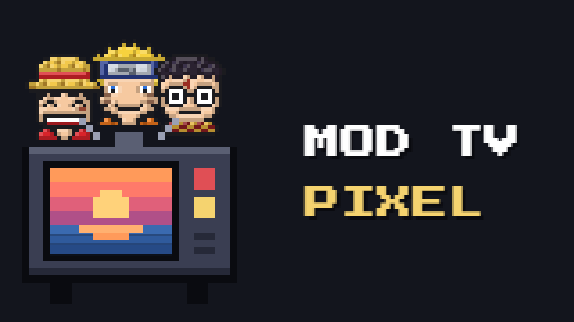
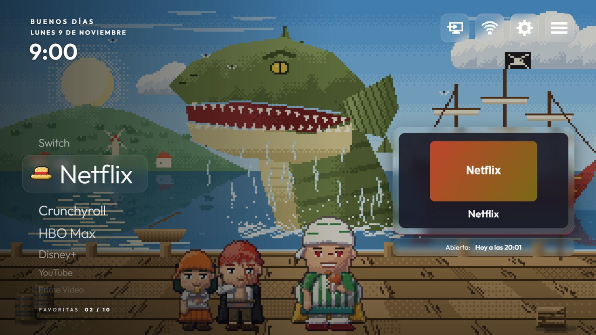
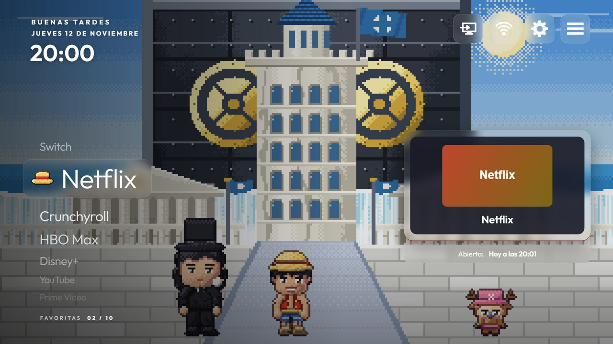
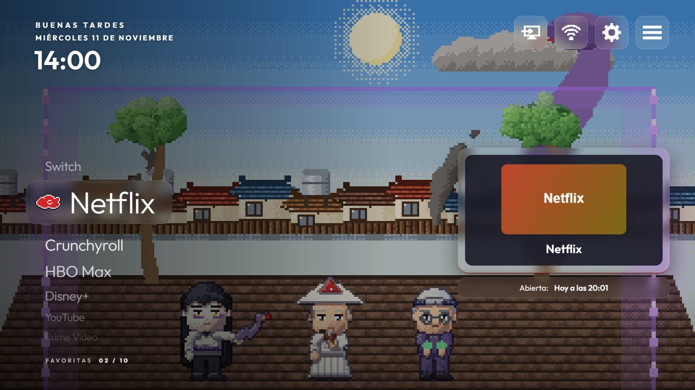
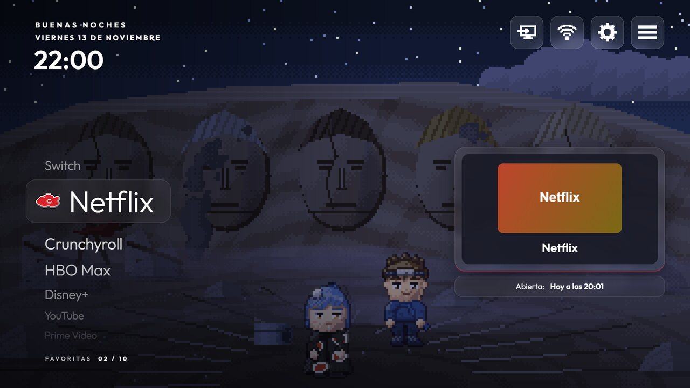
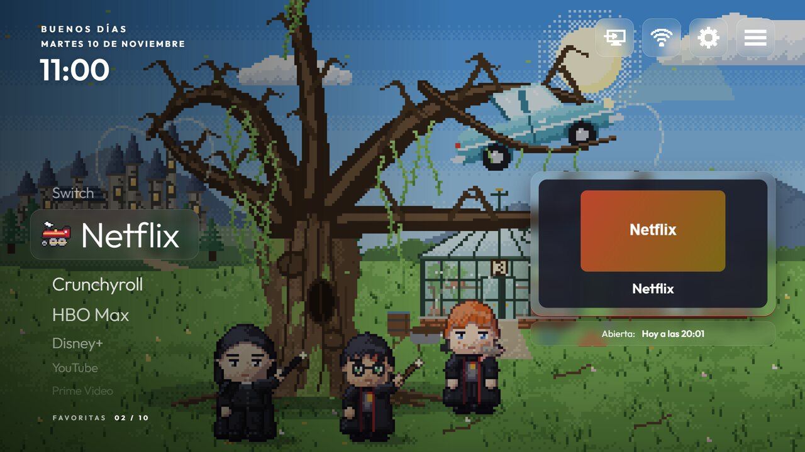
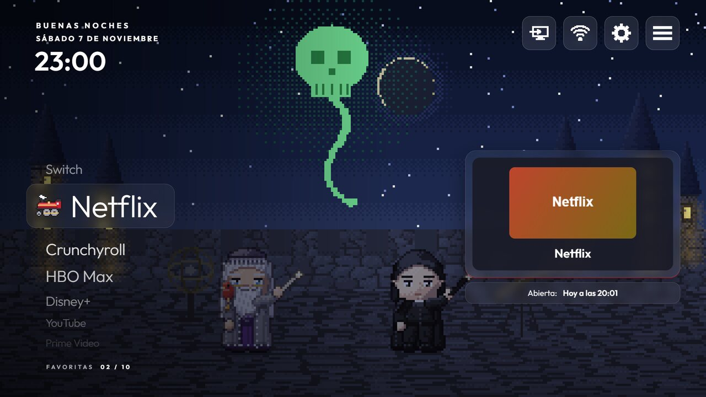
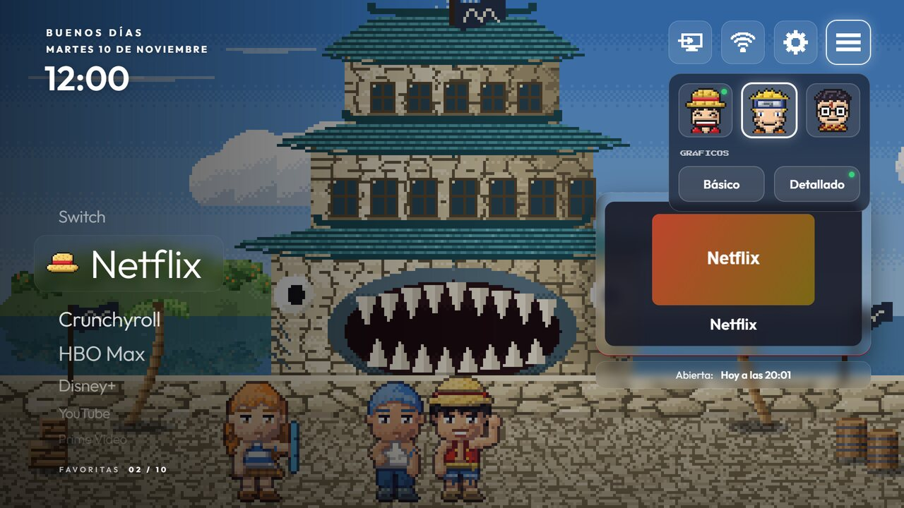

<div align="center">



Una pantalla de inicio en pixel art para Android TV.<br>
Tres sagas, piratas, ninjas y magos, que cambian con la hora y con el día de la semana.<br>
Dibujada a mano, píxel a píxel.

<br>

[](#instalarla)
[](#cómo-está-hecha)
[](#verla-en-el-ordenador)
[](LICENSE)

<br>

<a href="#qué-es"><b>Qué es</b></a> &nbsp;·&nbsp;
<a href="#instalarla"><b>Instalarla</b></a> &nbsp;·&nbsp;
<a href="#verla-en-el-ordenador"><b>En el ordenador</b></a> &nbsp;·&nbsp;
<a href="#cómo-está-hecha"><b>Cómo está hecha</b></a> &nbsp;·&nbsp;
<a href="#créditos"><b>Créditos</b></a> &nbsp;·&nbsp;
<a href="#in-english"><b>English</b></a>

</div>

## Qué es

Mod TV Pixel cambia la pantalla de inicio de una tele con Android TV por una escena en pixel art que vive con tu día:

- **Tres sagas, con su historia.** Piratas, Ninjas y Magos: cada día de la semana es un capítulo, y cada hora, un escenario.
  Son 119, con 303 personajes que salen cuando les toca.
- **La luz de cada hora.** El amanecer, el mediodía, el atardecer y la noche cambian los colores de cada escenario.
- **Cosas que pasan.** Cada dos o tres minutos, unos segundos de algo en la escena: 103 animaciones, una por escenario, y
  otras de cada saga.
- **Tus apps, a mano.** Las favoritas, en una rueda a la izquierda, con su cartel; arriba, las entradas HDMI, la red, los
  ajustes y un panel para cambiar de saga.
- **Y de salvapantallas,** la misma pantalla, recorriendo las horas de la semana.

<table>
<tr>
<td></td>
<td></td>
</tr>
<tr>
<td></td>
<td></td>
</tr>
<tr>
<td></td>
<td></td>
</tr>
</table>

<p align="center"></p>

## Instalarla

Hace falta una tele o un aparato con Android TV 8 o más, y [adb](https://developer.android.com/tools/adb) en el ordenador.

1. En la tele, activa las opciones de desarrollador y la depuración (por red o por USB).
2. Descarga el APK de la [última versión](../../releases) e instálalo:

   ```bash
   adb connect <ip-de-la-tele>
   adb install -r mod-tv-pixel.apk
   ```

3. Para que cada tarjeta diga cuándo abriste esa app por última vez, dale este permiso:

   ```bash
   adb shell appops set es.davidm.modtvpixel GET_USAGE_STATS allow
   ```

4. Pulsa el botón de inicio del mando y elige Mod TV Pixel. Si la tele no te deja elegir:

   ```bash
   adb shell cmd package set-home-activity es.davidm.modtvpixel/.Inicio
   ```

5. El salvapantallas, en los ajustes de la tele: Pantalla, Salvapantallas, Mod TV Pixel.

Está probada en una Xiaomi Mi TV P1 con Android TV 11.

**Para quitarle a la tele lo que no usas,** [CleanYourTV](https://github.com/Gathin23/cleanyourtv), de Gathin: desactiva
las apps que vienen de fábrica, por lotes y con copia para deshacerlo. Mod TV Pixel funciona con ella o sin ella.

## Verla en el ordenador

**Sin descargar nada:** [davidmcaru.github.io/mod-tv-pixel](https://davidmcaru.github.io/mod-tv-pixel/), en el navegador,
con la hora de ahora.

Las pantallas son páginas web: `index.html` las encaja en la ventana, y `web/piratas.html`, `web/ninjas.html` y
`web/magos.html` son cada una, a 1920 × 1080:

- `?dia=3&h=21` enseña otro día (0 es el domingo) y otra hora.
- Las flechas y Enter hacen lo que el mando.
- `?graficos=basico` quita lo que se mueve en el fondo, como en las teles más lentas.

## Compilarla

Con el JDK 17 y el SDK de Android 34:

```bash
./gradlew assembleRelease
```

El APK sale en `app/build/outputs/apk/release`.

## Cómo está hecha

- **`web/`, las pantallas:** HTML y canvas, sin librerías. `tele.js` y `pantalla.js` son lo común de las tres;
  `motor/`, la rueda de apps y lo que se mueve; `universos/`, los escenarios, los personajes, el horario de cada saga y
  sus animaciones.
- **`app/`, la app de Android:** un WebView a pantalla completa (`Inicio`), lo que las páginas le piden a la tele
  (`Lectura`: las apps, sus carteles, la red y las entradas HDMI) y el salvapantallas.
- **Sin internet:** todo va dentro de la app; solo mira si la tele va por cable o por wifi.

## Créditos

- **[CleanYourTV](https://github.com/Gathin23/cleanyourtv),** de Gathin, con licencia MIT: con ella se limpió la tele en la
  que nació esta pantalla.
- **Las letras,** [Press Start 2P](https://fonts.google.com/specimen/Press+Start+2P) y
  [Outfit](https://fonts.google.com/specimen/Outfit), con licencia SIL Open Font License 1.1 (`web/fuentes/OFL.txt`).
- Un proyecto personal y sin ánimo de lucro.

## Licencia

[MIT](LICENSE), de David M. Carrasco Ruiz. Las letras mantienen la suya.

## In English

Mod TV Pixel is a pixel-art home screen for Android TV. Three sagas (pirates, ninjas and wizards) follow the time of day
and the day of the week: 119 hand-drawn scenes, 303 characters and 103 small animations. Your favourite apps sit in a
wheel on the left, and the same screen doubles as a screensaver. Install the APK from the releases with `adb install`,
or open `web/piratas.html` in a browser to try it. MIT licensed; the fonts keep their SIL Open Font License.
